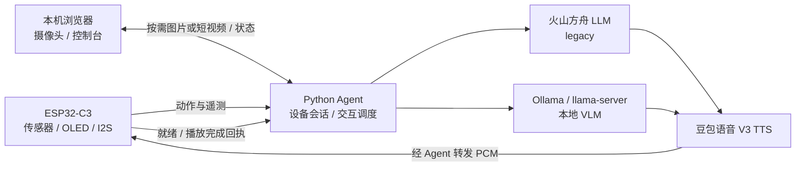

# Mimi

Mimi 是一个基于 ESP32-C3 与 Python Agent 的开源桌面 AI 互动原型。它通过 OLED 动态眼睛、触摸与姿态感知、语音回应，把用户的物理动作变成桌面上的互动；视觉模式还可以结合电脑摄像头画面生成回应。

ESP32 负责实时感知、本地表情和 I²S 音频播放，Python Agent 负责模型推理、交互调度与语音合成。两者通过 Wi-Fi 和 WebSocket 通信。Agent 离线时，设备仍运行本地感知与表情。

## 运行模式

| 模式 | 输入与模型 | 使用场景 |
|---|---|---|
| `legacy`（默认） | 设备动作 → 火山方舟流式 LLM | 不使用摄像头的动作互动 |
| `vlm` / `ollama` | 当前摄像头 JPEG、动作和最近遥测 → 本地视觉模型 | 单帧视觉互动 |
| `vlm` / `llama-server` | 浏览器最近完成的短视频片段、动作和最近遥测 → 本地视觉模型 | 短视频视觉互动 |

两种运行模式都使用豆包语音 V3 TTS，生成 16 kHz、16 bit、单声道 PCM 并发送给 ESP32 播放。视觉模型需要自行部署，MiniCPM-V 4.6 是当前配置示例。

## 当前能力

- SSD1306 128×64 OLED 动态眼睛、注视、眨眼和情绪动画；
- MPU6050 姿态与运动特征、TTP223 触摸输入；
- 触摸、倾斜和摇晃事件触发回应，动作证据过滤与语音冷却；
- `legacy` 模式按设备连接保存最近 10 轮完成的对话，使用流式 LLM 与 TTS；
- `vlm` 模式提供原生 HTML/CSS/JavaScript 控制台，显示摄像头、传感器、模型回复、耗时和语音状态；
- 视觉分析由传感器事件或“立即分析”触发；全局只执行一个视觉交互任务，忙时保留最新一个传感器事件；
- 没有 ESP32 时可手动验证视觉分析，页面展示回复并跳过语音播放；
- VLM 语音链路支持设备就绪和播放完成回执，区分音频发送完成与设备播放完成。

## 系统架构



设备服务默认监听 `0.0.0.0:8765`，供局域网 ESP32 连接。视觉控制台默认监听 `127.0.0.1:8090`，浏览器打开 `http://localhost:8090`。

## 开始使用

1. 按 [接线与供电](docs/wiring.md) 连接 ESP32、OLED、MPU6050、触摸和音频模块。
2. 复制 `firmware/config/network_secrets.h.example` 为 `network_secrets.h`，填写 Wi-Fi 和电脑局域网地址。
3. 安装并配置 Agent：

```bash
cd /path/to/mimi/agent
python3 -m venv .venv
source .venv/bin/activate
python -m pip install -e '.[dev]'
cp .env.example .env
```

两种模式都需填写 `.env` 中的 `VOLCENGINE_API_KEY`、`VOLCENGINE_RESOURCE_ID` 和 `VOLCENGINE_VOICE_TYPE`。默认 `legacy` 模式还需填写 `ARK_API_KEY` 和 `ARK_MODEL`：

```bash
PYTHONPATH=src python -m mimi_agent.application.server
```

使用视觉模式时，先启动本地模型服务，再设置对应的 provider、接口地址与实际模型名称。例如 Ollama：

```bash
MIMI_RUNTIME_MODE=vlm \
MIMI_VLM_PROVIDER=ollama \
MIMI_VLM_BASE_URL=http://127.0.0.1:11434/v1 \
MIMI_VLM_MODEL=minicpm-v-4.6-local \
PYTHONPATH=src python -m mimi_agent.application.server
```

打开 `http://localhost:8090`，点击“启动摄像头”，授权后点击“立即分析”。llama-server 视频路径的配置见 [Agent 使用说明](agent/README.md)。

4. 编译并烧录固件：

```bash
cd /path/to/mimi
platformio run --target upload --environment esp32-c3-supermini
```

完整启动、验收和排错流程见 [操作手册](docs/操作手册.md)；只验证固件启动可看 [快速开始](quick_start.md)。

## 当前限制

- 没有麦克风输入、ASR、舵机或机械运动；
- 没有定时视觉推理、长期视觉记忆或 VLM 多轮对话历史；浏览器本地录制不等于持续向模型上传视频；
- VLM 输出自然语言，不使用结构化决策 JSON，也不直接控制 OLED 像素；
- Ollama 在摄像头不可用时允许传感器事件仅用文本推理；llama-server 没有视频时停止本次请求并显示错误；
- VLM 请求失败不会自动切换 Ark，需设置 `MIMI_RUNTIME_MODE=legacy` 并重启；
- 视觉模式面向一台设备与一个本机浏览器，多设备、多摄像头仲裁尚未实现；
- 当前推荐从源码以 editable 方式安装；wheel 静态页面打包尚待修复；
- 当前为开发原型，电池供电、外壳和实物长期运行仍需验证。

## 技术栈与目录

固件采用 C++、Arduino-ESP32、PlatformIO；Agent 使用 Python 3.11+、asyncio、aiohttp、httpx 与 websockets。音频通过 ESP32 I²S、MAX98357A 和扬声器输出。

| 目录 | 内容 |
|---|---|
| `firmware/` | 传感器、行为、OLED、音频与网络固件 |
| `agent/` | Python 服务、模型客户端、WebUI、TTS 和测试 |
| `docs/` | 公开接线、协议、操作与开发说明 |
| `platformio.ini` | 固件构建配置 |

## 开发与提交

```bash
cd /path/to/mimi/agent
python -m pytest -q
cd /path/to/mimi
platformio run --environment esp32-c3-supermini
```

普通测试使用模拟模型和 TTS；在线测试需显式设置 `MIMI_RUN_LIVE_TESTS=1`，测试通过不代表摄像头、模型和实物联调通过。

`.env` 与 `network_secrets.h` 是本地私密配置，不提交密钥、日志、音频和构建产物。私有设计材料与硬件原始资料只保留本地，提交时明确选择公开文件。设备协议尚无认证层，服务仅用于可信开发局域网，不应直接暴露公网。

## 许可证

本项目采用 [MIT License](LICENSE)，第三方依赖遵循各自许可证。
