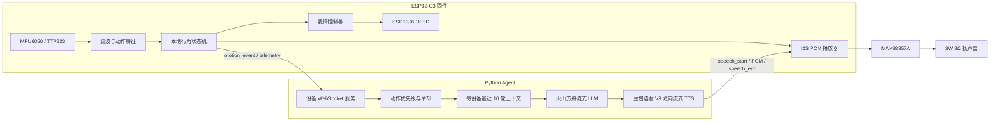
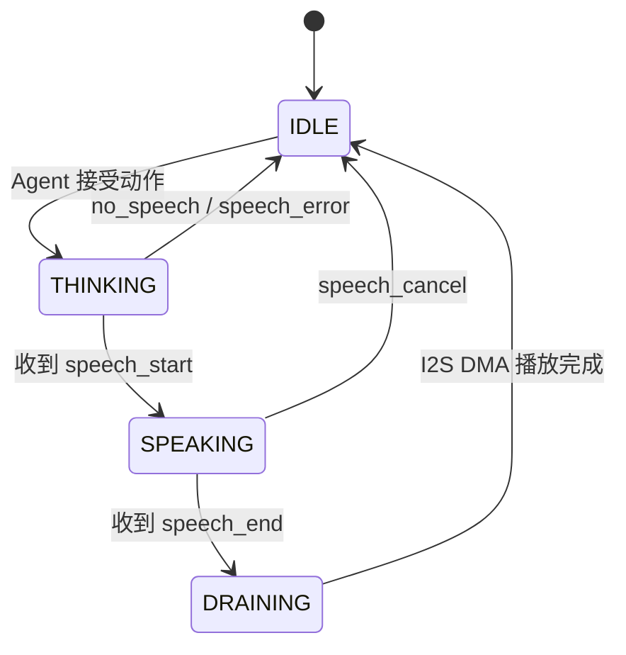
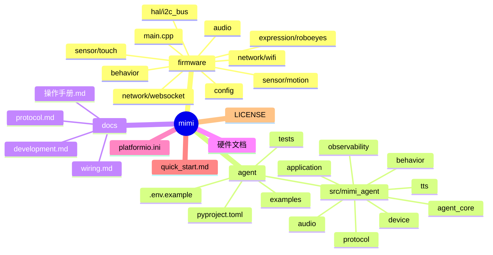

# Mimi

Mimi 是一个基于 ESP32-C3 的桌面互动 AI 宠物原型。它把姿态、触摸、OLED 表情和语音输出组合成一个可以放在桌面上的实体终端：ESP32 负责实时感知与本地表情，Python Agent 负责 LLM、TTS 和网络编排。

项目当前已经可以完成一条真实闭环：传感器动作经过 ESP32 本地行为处理后，通过 WebSocket 送入火山方舟 LLM 和豆包 TTS，最终以 PCM 形式交给 MAX98357A 播放。

## 当前能力

- SSD1306 128×64 I²C OLED 动态眼睛、注视方向、眨眼和情绪动画；
- MPU6050 姿态、角速度、动态加速度、稳定性和动作持续时间特征提取；
- TTP223 数字触摸输入与 50 ms 消抖；
- 本地行为模式：平静、好奇、兴奋、眩晕、困倦；
- 触摸、倾斜和摇晃动作上报给 Agent；
- 火山方舟图文流式 LLM，关闭思考输出；
- 每个设备会话保留最近 10 轮 LLM 上下文，system prompt 始终存在；
- 豆包语音 V3 双向流式 TTS；
- 16 kHz、16 bit、单声道 PCM 通过 WebSocket 转发到 ESP32；
- `speech_start` 到达后再提交 OLED 反应，确保表情与声音同步开始；
- PCM 播放完成后回到默认表情；
- Agent 不可用时，ESP32 仍然运行本地感知与表情。

## 不属于当前版本

- 麦克风、语音输入和 ASR；
- 持续视频流和视频记忆；
- ESP32 本地 LLM、ASR 或 TTS；
- 舵机和机械运动；
- 电池及长时间独立供电的最终验证；
- Agent 远程下发像素级 OLED 指令。

## 系统架构



## 表情与语音生命周期



关键原则：`speech_start` 不是 LLM 请求开始，而是第一块可播放 PCM 已经准备好。ESP32 在这个边界同时提交动作表情并开始播放音频。

## 技术栈

| 层 | 技术 |
|---|---|
| 固件语言 | C++ |
| 固件框架 | Arduino-ESP32 |
| 固件构建 | PlatformIO |
| 主控 | ESP32-C3 SuperMini |
| 显示 | SSD1306、Adafruit GFX、Adafruit SSD1306、RoboEyes |
| 传感器 | MPU6050、TTP223 |
| 音频 | ESP32 I2S、MAX98357A、PCM |
| 设备通信 | Wi-Fi、WebSocket |
| Agent 语言 | Python 3.11+ |
| LLM | 火山方舟 Chat Completions，图文流式 |
| TTS | 豆包语音 V3 WebSocket 双向流式 |
| 控制协议 | JSON 文本帧 |
| 音频协议 | WebSocket 二进制 PCM 帧 |
| 开源协议 | MIT |

JSON 只是设备通信格式，不是固件编程语言。Python 只运行在 Agent 所在的电脑或服务器上。

## 目录



## 开始使用

最快路径：

1. 按 [硬件接线文档](docs/wiring.md) 连接 OLED、MPU6050、TTP223 和音频模块；
2. 在 `firmware/config/network_secrets.h` 写入 Wi-Fi 和 Agent 地址；
3. 在 `agent/.env` 写入 LLM 与 TTS 凭据；
4. 按 [完整操作手册](docs/操作手册.md) 的顺序启动 Agent、编译、烧录和验证；
5. 只想快速烧录固件时，查看 [quick_start.md](quick_start.md)。

```bash
cd /path/to/mimi
platformio run --target upload --environment esp32-c3-supermini
```

如果 `platformio` 不在 PATH 中，可以使用 PlatformIO IDE 的 Build/Upload/Monitor 操作，或先执行：

```bash
export PATH="$HOME/.platformio/penv/bin:$PATH"
```

## 配置和安全

- `firmware/config/network_secrets.h` 是本地私密配置，已被 Git 忽略；只提交 `.example` 模板；
- `agent/.env` 只保存在本地，API Key 不应出现在源码、日志、截图或提交记录中；
- `agent/cache/`、`agent/logs/` 和 `.pio/` 都是运行生成物，不是源码；
- Agent 默认监听局域网 `0.0.0.0:8765`，只建议在可信的家庭/开发局域网内使用；
- 当前设备协议没有认证层，不应直接暴露到公网。

## 开发与验证

```bash
cd /path/to/mimi/agent
python -m pytest -q
```

固件验证：

```bash
cd /path/to/mimi
platformio run --environment esp32-c3-supermini
```

完整的启动顺序、串口验收日志、故障排查和停止服务方法见 [docs/操作手册.md](docs/操作手册.md)。协议字段见 [docs/protocol.md](docs/protocol.md)。

## 许可证

本项目采用 [MIT License](LICENSE)。第三方库仍以其各自许可证为准，硬件厂商资料仅作为本地开发参考，不代表本项目拥有其版权。
