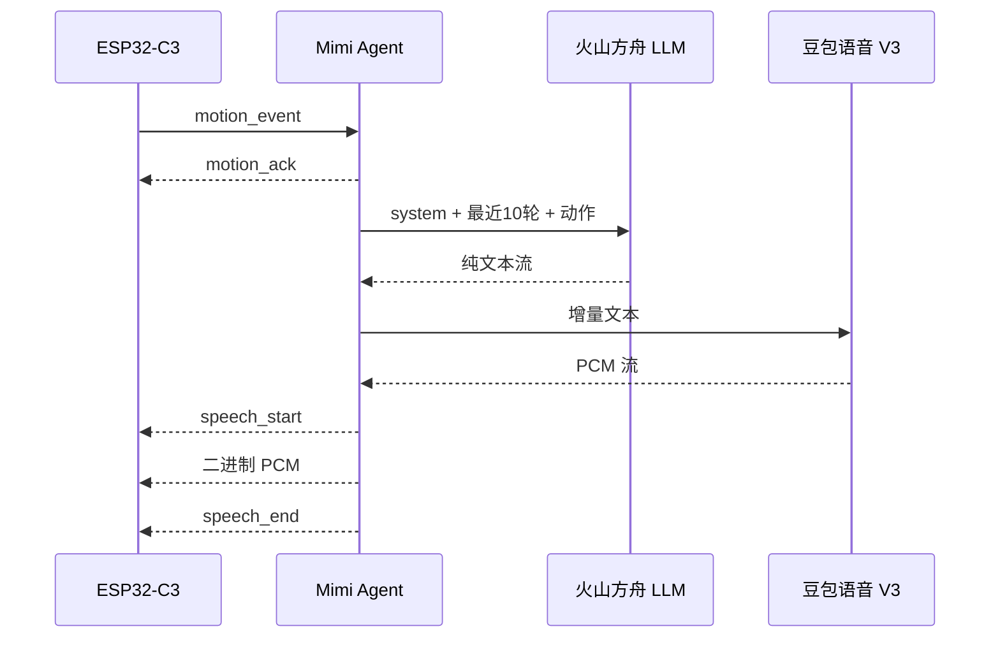
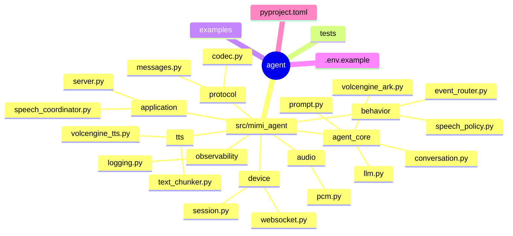

# Mimi Agent

`agent/` 是 Mimi 的 Python 服务端。它负责设备 WebSocket 会话、动作策略、火山方舟 LLM、豆包语音 V3 TTS 和 PCM 音频转发。

ESP32 不运行 Python，也不承担云端推理。设备负责传感器读取、本地动作判断、OLED 表情和 I2S 播放；Agent 负责生成自然语言和音频。

## 数据流



## 目录



## 配置

复制模板：

```bash
cd /path/to/mimi/agent
cp .env.example .env
```

至少填写：

| 变量 | 说明 |
|---|---|
| `ARK_API_KEY` | 火山方舟 API Key |
| `ARK_MODEL` | 已开通的方舟模型或推理接入点 ID |
| `VOLCENGINE_API_KEY` | 豆包语音 API Key |
| `VOLCENGINE_RESOURCE_ID` | TTS 资源 ID |
| `VOLCENGINE_VOICE_TYPE` | 已开通的音色 ID |

默认行为参数：

| 变量 | 默认值 | 说明 |
|---|---:|---|
| `ARK_CONTEXT_TURNS` | `10` | 每个设备会话保留的完整对话轮数 |
| `ARK_MAX_TOKENS` | `24` | LLM 单次最大输出 token 数 |
| `MIMI_AUDIO_SAMPLE_RATE` | `16000` | PCM 采样率 |
| `MIMI_SPEECH_DEFAULT_COOLDOWN_MS` | `2500` | 普通动作语音冷却 |
| `MIMI_SPEECH_DIZZY_COOLDOWN_MS` | `5000` | 摇晃/眩晕语音冷却 |

`system prompt` 不占用 `ARK_CONTEXT_TURNS`，每次 LLM 请求都会放在 messages 的第一条。历史只保存已经完成的“用户动作输入 + Mimi 回复”轮次；设备断开后清理会话历史。

## 启动

```bash
cd /path/to/mimi/agent
python3 -m venv .venv
source .venv/bin/activate
python -m pip install -e '.[dev]'
PYTHONPATH=src python -m mimi_agent.application.server
```

服务监听 `ws://0.0.0.0:8765`。启动前会校验 LLM、TTS 和音频配置，缺少密钥时直接失败，不使用固定文案兜底。

## 测试

```bash
cd /path/to/mimi/agent
python -m pytest -q
```

本地验证完整的 LLM → TTS → WAV 流程：

```bash
PYTHONPATH=src python examples/pipeline_smoke.py
afplay cache/pipeline-smoke.wav
```

在线集成测试需要显式开启：

```bash
MIMI_RUN_LIVE_TESTS=1 PYTHONPATH=src python -m pytest -q -m integration
```

测试和示例产生的 `cache/`、`logs/` 都是运行产物，不提交到仓库。

## 设计约束

- 一台设备连接对应一个 `DeviceSession`；
- 同一会话只允许一个活动语音任务；更高优先级动作可以取消当前任务；
- LLM 只输出纯文本，不输出 JSON、字段名或分析过程；
- TTS 输入按文本边界增量提交，但只有 LLM 完成后才结束 TTS 会话；
- 第一块 PCM 到达后才发送 `speech_start`；
- Agent 不向设备发送像素数据，只发送事件确认、语音生命周期和 PCM；
- 设备协议详见 [../docs/protocol.md](../docs/protocol.md)。
