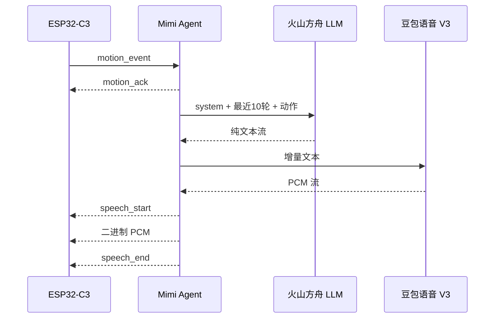
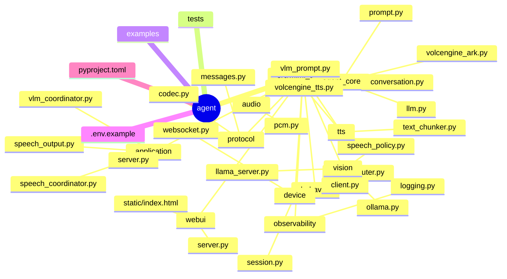

# Mimi Agent

`agent/` 是 Mimi 的 Python 服务端。它负责设备 WebSocket 会话、动作策略、火山方舟 LLM、Ollama MiniCPM-V 视觉模型、豆包语音 V3 TTS 和 PCM 音频转发。

ESP32 不运行 Python，也不承担云端推理。设备负责传感器读取、本地动作判断、OLED 表情和 I2S 播放；Agent 负责生成自然语言和音频。

## 数据流



当 `MIMI_RUNTIME_MODE=vlm` 时，Agent 还会启动本地视觉控制台：浏览器负责摄像头预览和短视频采集，Agent 将视频、ESP32 事件与遥测合并后请求配置的本地 VLM。默认 `legacy` 模式使用 Ark 路径；切换模式需要重启，不会在 VLM 出错后自动回退。视觉分析只由传感器事件或手动操作触发，当前没有周期推理。

## 目录



## 配置

复制模板：

```bash
cd /path/to/mimi/agent
cp .env.example .env
```

两种模式都需填写 TTS 的 `VOLCENGINE_API_KEY`、`VOLCENGINE_RESOURCE_ID` 和 `VOLCENGINE_VOICE_TYPE`。只有 `legacy` 模式需要 Ark 配置：

| 变量 | 说明 |
|---|---|
| `ARK_API_KEY` | 火山方舟 API Key |
| `ARK_MODEL` | 已开通的方舟模型或推理接入点 ID |
| `VOLCENGINE_API_KEY` | 豆包语音 API Key |
| `VOLCENGINE_RESOURCE_ID` | TTS 资源 ID |
| `VOLCENGINE_VOICE_TYPE` | 已开通的音色 ID |

默认行为参数：

| 变量 | 默认值 | 说明 |
|---|---:|---|
| `ARK_CONTEXT_TURNS` | `10` | 每个设备会话保留的完整对话轮数 |
| `ARK_MAX_TOKENS` | `24` | LLM 单次最大输出 token 数 |
| `MIMI_AUDIO_SAMPLE_RATE` | `16000` | PCM 采样率 |
| `MIMI_SPEECH_DEFAULT_COOLDOWN_MS` | `2500` | 普通动作语音冷却 |
| `MIMI_SPEECH_DIZZY_COOLDOWN_MS` | `5000` | 摇晃/眩晕语音冷却 |

VLM 模式配置：

| 变量 | 默认值 | 说明 |
|---|---:|---|
| `MIMI_RUNTIME_MODE` | `legacy` | `legacy` 或 `vlm` |
| `MIMI_WEBUI_HOST` | `127.0.0.1` | 本地页面监听地址 |
| `MIMI_WEBUI_PORT` | `8090` | 摄像头控制台端口 |
| `MIMI_VLM_PROVIDER` | `ollama` | `ollama` 使用图片；`llama-server` 使用视频/图片 |
| `MIMI_VLM_BASE_URL` | `http://127.0.0.1:11434/v1` | VLM 的 OpenAI 兼容接口；llama-server 通常为 `http://127.0.0.1:8080/v1` |
| `MIMI_VLM_MODEL` | 空 | provider 中实际使用的模型名或 alias |
| `MIMI_VLM_MAX_TOKENS` | `256` | 单次视觉回复上限 |
| `MIMI_VLM_REQUEST_TIMEOUT_SECONDS` | `30` | VLM 请求超时 |
| `MIMI_VLM_VIDEO_WINDOW_SECONDS` | `1` | llama-server 每次分析取触发前的视频时长 |
| `MIMI_CAMERA_CAPTURE_TIMEOUT_SECONDS` | `2` | 浏览器返回当前帧的超时 |
| `MIMI_CAMERA_JPEG_QUALITY` | `0.75` | JPEG 抽帧质量 |
| `MIMI_CAMERA_MAX_EDGE` | `320` | 摄像头画面最长边限制 |
| `MIMI_CAMERA_FRAME_RATE` | `4` | 摄像头视频帧率上限 |

以下上下文规则仅适用于 `legacy`；VLM 使用固定角色提示词、示例对话和当前感知，没有多轮会话历史。

`system prompt` 不占用 `ARK_CONTEXT_TURNS`，每次 LLM 请求都会放在 messages 的第一条。历史只保存已经完成的“用户动作输入 + Mimi 回复”轮次；设备断开后清理会话历史。

## 启动

```bash
cd /path/to/mimi/agent
python3 -m venv .venv
source .venv/bin/activate
python -m pip install -e '.[dev]'
PYTHONPATH=src python -m mimi_agent.application.server
```

服务默认监听 `ws://0.0.0.0:8765`。启动时两种模式都校验 TTS 配置，`legacy` 校验 Ark 配置，`vlm` 校验本地视觉服务配置。即使只在页面验证模型，两种模式都需要有效的 TTS 配置。当前请使用源码 editable 安装，wheel 尚未包含 WebUI 静态页面。

启用本地 MiniCPM-V（Ollama 图片路径）：

```bash
cd /path/to/mimi/agent
MIMI_RUNTIME_MODE=vlm \
MIMI_VLM_PROVIDER=ollama \
MIMI_VLM_MODEL=minicpm-v-4.6-local \
PYTHONPATH=src python -m mimi_agent.application.server
```

启用 `llama-server` 视频路径：

```bash
cd /path/to/mimi/agent
MIMI_RUNTIME_MODE=vlm \
MIMI_VLM_PROVIDER=llama-server \
MIMI_VLM_BASE_URL=http://127.0.0.1:8080/v1 \
MIMI_VLM_MODEL=minicpm-v-4.6 \
MIMI_VLM_VIDEO_WINDOW_SECONDS=1 \
PYTHONPATH=src python -m mimi_agent.application.server
```

`llama-server` 必须使用带 `--mmproj` 的视觉模型服务，并且服务端所在环境需要能找到 `ffprobe`/`ffmpeg`。默认 WebUI 在浏览器内滚动录制约 1 秒的完整视频片段；触发时发送最近已完成的片段（可能短于配置窗口），默认最长边 320px、最高 4fps。服务端通过 `input_video` 传给 llama-server，不将视频拆成图片。浏览器实际编码由 MediaRecorder 支持的格式决定；刚启动摄像头时需等待首段视频录制完成。

然后打开 <http://localhost:8090>，点击“启动摄像头”。VLM 模式仍监听设备 WebSocket `8765`，页面只监听本机 `8090`。模型忙时只执行一个请求；传感器事件会保留最新一个待处理事件。

回退到旧路径：

```bash
MIMI_RUNTIME_MODE=legacy PYTHONPATH=src python -m mimi_agent.application.server
```

## 测试

```bash
cd /path/to/mimi/agent
python -m pytest -q
```

本地验证完整的 LLM → TTS → WAV 流程：

```bash
PYTHONPATH=src python examples/pipeline_smoke.py
afplay cache/pipeline-smoke.wav
```

在线集成测试需要显式开启：

```bash
MIMI_RUN_LIVE_TESTS=1 PYTHONPATH=src python -m pytest -q -m integration
```

## 格式化与静态检查

项目使用 pre-commit 管理 Ruff 格式化和基础静态检查。首次使用时在仓库根目录执行：

```bash
python -m pip install pre-commit
pre-commit install
pre-commit run --all-files
```

Ruff 配置位于 `agent/pyproject.toml`；提交前会自动修复可修复的格式和导入问题。

测试和示例产生的 `cache/`、`logs/` 都是运行产物，不提交到仓库。

## 交互与输出规则

- `legacy` 按设备连接保存对话历史，较高优先级动作可取消当前语音任务；
- `vlm` 全局串行处理推理与语音，忙时手动分析被拒绝，传感器事件只保留最新一个等待项；
- VLM 返回完整自然语言文本后再开始 TTS，不使用 JSON 决策字段；空文本、含英文占位词 `something` 的回复及与上一条仅空白不同的回复会被抑制；
- Ollama 触发时请求当前 JPEG；摄像头不可用时仅传感器事件允许无图推理，手动分析报错；
- llama-server 触发时请求最近视频片段；没有视频时不请求模型、不播放语音；
- 没有已连接设备时，手动分析仍展示模型结果，但跳过 TTS；
- 第一块 PCM 就绪后发送 `speech_start`；VLM 输出在设备声明两项回执能力时，等待 `speech_ready` 后发送 PCM，等待 `speech_playback_end` 后确认播放完成；
- 未声明回执能力的设备仍能接收音频，但页面只显示发送完成、播放未确认；
- Agent 不向设备发送像素数据；详细消息见 [设备协议](../docs/protocol.md)。
