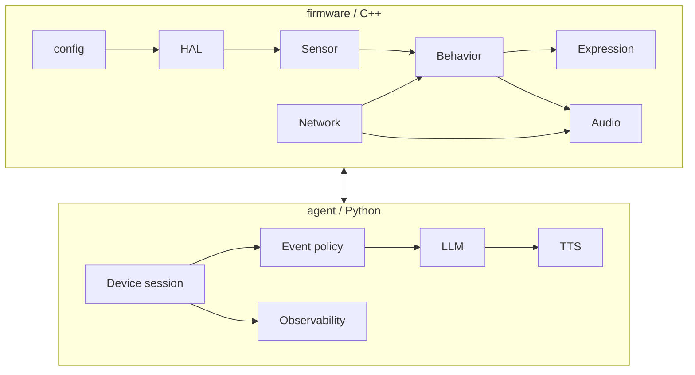
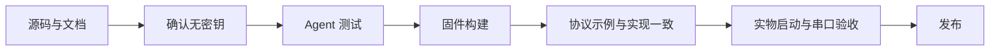

# 开发说明

## 边界



固件与 Agent 通过公开的设备协议交互。固件不依赖 Python，Agent 不依赖 ESP32 的具体像素实现。

## 固件模块职责

| 目录 | 职责 |
|---|---|
| `firmware/config` | GPIO、I²C 地址、音频和调试参数 |
| `firmware/hal/i2c_bus` | I²C 初始化与扫描 |
| `firmware/sensor/motion` | MPU6050 读取、滤波、动作状态和连续特征 |
| `firmware/sensor/touch` | TTP223 消抖和触摸边沿 |
| `firmware/behavior` | 行为评分、优先级、表情生命周期 |
| `firmware/expression` | RoboEyes 适配和显示动画 |
| `firmware/audio` | I²S 初始化、PCM 缓冲、音量和 DMA drain |
| `firmware/network` | Wi-Fi 和 Agent WebSocket 连接 |
| `firmware/main.cpp` | 初始化依赖并驱动主循环 |

当前没有独立的 `event` 和 `protocol` 固件目录；动作识别位于 `sensor/motion`，设备协议编解码位于 `network/websocket`。不要为了目录形式保留空的模块占位文件。

## Agent 模块职责

| 目录 | 职责 |
|---|---|
| `application` | 按模式组装服务，legacy 流式编排、VLM 串行调度与语音输出 |
| `agent_core` | LLM 请求模型、system prompt、会话上下文和 Ark 客户端 |
| `behavior` | 事件键、优先级和冷却策略 |
| `device` | WebSocket 会话发送锁、设备接入和 PCM 分帧 |
| `protocol` | JSON 消息编码和设备事件解析 |
| `audio` | PCM 格式校验 |
| `tts` | 文本分段、豆包语音双向 WebSocket 和增量 PCM |
| `observability` | 芯片、LLM 输入输出和语音时序日志 |
| `vision` | Ollama 图片与 llama-server 图片/视频客户端、响应解析 |
| `webui` | aiohttp 页面与浏览器 WebSocket、按需图片和短视频采集 |

## 本地上下文

`legacy` 模式的 `ConversationHistory` 以设备连接为边界，默认保存 10 个完成轮次。每次请求都重新生成：

1. 固定 system prompt；
2. 最近的 user/assistant 对；
3. 当前动作的 user prompt。

历史不写入磁盘，不同设备不会共享。断开连接或 Agent 关闭时释放。

## 视觉模式边界

浏览器负责权限、预览、JPEG 抽帧与 MediaRecorder 短视频录制；Agent 合并动作和最近遥测后调用本地模型。当前只支持事件与手动触发，没有周期推理或结构化 JSON 决策。VLM 不保存多轮历史，全局一次处理一个完整交互，忙时仅保留最新传感器事件。

Ollama 无图时允许事件文本推理；llama-server 无视频时终止请求。VLM 失败不自动回退 Ark。两条模型路径均复用豆包 TTS，VLM 输出还等待支持该能力的设备回执。

## 构建和测试

固件：

```bash
cd /path/to/mimi
platformio run --environment esp32-c3-supermini
platformio run --target upload --environment esp32-c3-supermini --upload-port /dev/cu.usbmodemXXXX
```

Agent：

```bash
cd /path/to/mimi/agent
source .venv/bin/activate
python -m pytest -q
```

在线测试必须显式设置 `MIMI_RUN_LIVE_TESTS=1`，普通测试不访问云端。

## 代码修改原则

- 先确定数据边界，再修改实现；
- 传感器只提供数据，不直接操作 OLED 或扬声器；
- 网络层只负责连接和消息，不把云端字段扩散到表情实现；
- 所有跨网络动作使用 `event_id` 和 `speech_id` 关联；
- 不增加固定文案兜底来掩盖 LLM/TTS 错误；
- 对硬件行为添加日志和可观察状态；
- 新增配置时同时更新 `.env.example`、操作手册和测试；
- 不提交密钥、日志、音频、PlatformIO 构建目录、Python 虚拟环境或缓存。

## 发布前检查



建议至少完成：

- `python -m pytest -q` 全部通过；
- `platformio run --environment esp32-c3-supermini` 成功；
- I²C 扫描能找到 OLED 和 MPU6050；
- TTP223 有 pressed/released 日志；
- Agent 能接收两个连续动作；
- 语音链路出现 `Speech start`、`Speech end`、`reaction playback complete`；
- 提交范围不含 `.env`、`network_secrets.h`、日志、音频、缓存、构建产物或私有设计材料；
- WebUI 摄像头授权、手动分析、设备事件与两种 provider 分别完成实际验证；
- 区分 TTS 发送完成与设备播放回执，验证连续两次语音；
- 检查安装包是否包含 `webui/static/index.html`；当前 wheel 尚未包含，源码 editable 安装可用于开发。
