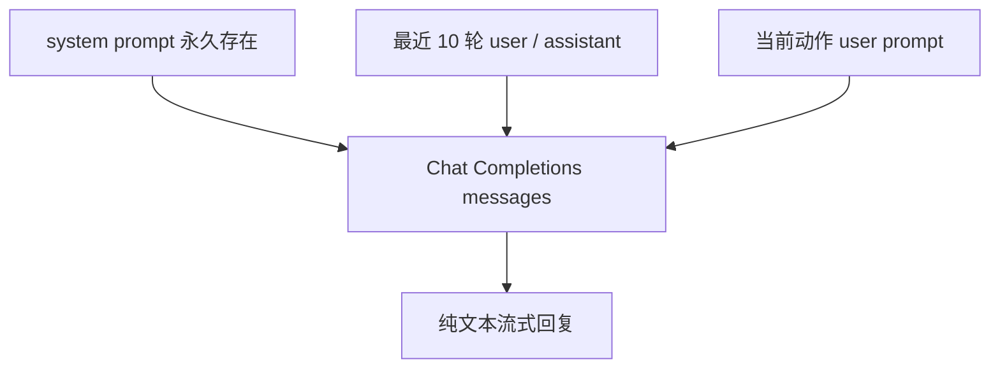

# Mimi 设备协议

当前协议版本是 `mimi.v1`，传输层是 WebSocket。控制消息使用 UTF-8 JSON 文本帧，音频使用二进制帧。

## 生命周期

```mermaid
sequenceDiagram
    participant D as ESP32
    participant A as Agent

    D->>A: hello
    A-->>D: hello_ack
    D->>A: motion_event
    A-->>D: motion_ack
    A-->>D: speech_start
    A-->>D: PCM binary frames
    A-->>D: speech_end
    Note over D: I2S DMA drain
    D: playback_end（本地状态）
```

`speech_start`、`speech_end` 和 `speech_error` 都属于同一个语音会话；动作和语音通过 `event_id` 关联。设备只有在收到 `speech_start` 后才提交最终动作表情。

## ESP32 → Agent

### `hello`

设备连接后发送一次：

```json
{
  "type": "hello",
  "device_id": "mimi-c3-01",
  "protocol": "mimi.v1",
  "audio": {
    "format": "pcm_s16le",
    "sample_rate": 16000,
    "channels": 1
  }
}
```

### `motion_event`

动作事件是固件运动估计器的结果，不是每 20 ms 一条原始 IMU 数据：

```json
{
  "type": "motion_event",
  "event_id": "evt-123456",
  "event": "shaking",
  "behavior": "dizzy",
  "intensity": 0.72,
  "timestamp_ms": 123456,
  "roll_deg": 1.2,
  "pitch_deg": 14.9,
  "angular_speed_dps": 125.0,
  "acceleration_norm_g": 1.08,
  "dynamic_acceleration_g": 0.08,
  "stability": 0.42,
  "tilt_strength": 0.25,
  "peak_angular_speed_dps": 210.0,
  "peak_dynamic_acceleration_g": 0.31,
  "confidence": 0.94,
  "still_duration_ms": 0,
  "state_duration_ms": 60,
  "motion_duration_ms": 680
}
```

当前可触发 Agent 语音策略的事件包括：

| event | 含义 |
|---|---|
| `touch` | TTP223 被触摸 |
| `tilt_left` / `tilt_right` | 向左/向右倾斜 |
| `tilt_forward` / `tilt_backward` | 向前/向后倾斜 |
| `shaking` | 摇晃 |

### `sensor_telemetry`

传感器遥测用于日志和诊断，不直接触发 LLM：

```json
{
  "type": "sensor_telemetry",
  "timestamp_ms": 123456,
  "accel_x_g": 0.48,
  "accel_y_g": 0.04,
  "accel_z_g": 0.86,
  "gyro_x_dps": -5.0,
  "gyro_y_dps": -13.2,
  "gyro_z_dps": -7.1,
  "state": "shaking",
  "behavior": "dizzy",
  "touch_active": false,
  "roll_deg": 1.2,
  "pitch_deg": 14.9,
  "angular_speed_dps": 125.0,
  "motion_intensity": 0.72,
  "acceleration_norm_g": 1.08,
  "dynamic_acceleration_g": 0.08,
  "stability": 0.42,
  "tilt_strength": 0.25,
  "peak_angular_speed_dps": 210.0,
  "peak_dynamic_acceleration_g": 0.31,
  "confidence": 0.94,
  "still_duration_ms": 0,
  "state_duration_ms": 60,
  "motion_duration_ms": 680
}
```

## Agent → ESP32

### `hello_ack`

```json
{"type":"hello_ack","protocol":"mimi.v1"}
```

### `motion_ack`

Agent 对每一个动作事件回复一次：

```json
{"type":"motion_ack","event_id":"evt-123456","will_speak":true}
```

`will_speak=false` 表示动作被策略过滤，例如处于冷却窗口或当前语音优先级更高。设备收到后回到本地空闲表情。

### `speech_start`

第一块可播放 PCM 已经从 TTS 到达 Agent 后发送：

```json
{
  "type": "speech_start",
  "speech_id": "sp-123",
  "event_id": "evt-123456",
  "text": "别晃啦，",
  "text_complete": false,
  "format": "pcm_s16le",
  "sample_rate": 16000,
  "channels": 1
}
```

`text` 是当前已经提交给 TTS 的文本前缀，不保证是完整回复；`text_complete=true` 只表示 LLM 已经完成。

### PCM 二进制帧

`speech_start` 后的二进制 WebSocket 帧全部是：

- little-endian；
- signed 16-bit；
- mono；
- 16 kHz；
- 每帧不超过 4096 字节；
- 偶数字节长度，不能拆开一个 PCM sample。

设备把 mono PCM 复制到 I²S 左右声道，并在固件中进行数字音量缩放。

### `speech_end`

```json
{"type":"speech_end","speech_id":"sp-123"}
```

该消息表示 Agent 已经发送全部 PCM，不代表扬声器已经停止。ESP32 还要等待 I²S DMA 尾部播放完成，随后本地才产生 `playback_end` 并恢复默认表情。

### `speech_cancel` 和 `speech_error`

```json
{"type":"speech_cancel","speech_id":"sp-123"}
```

```json
{
  "type": "speech_error",
  "speech_id": "sp-123",
  "event_id": "evt-123456",
  "message": "TTS request failed"
}
```

设备收到取消或错误后会停止当前 PCM、取消等待中的表情，并回到空闲状态。

## Agent 内部 LLM messages

每次请求使用以下结构：



历史按设备连接隔离，超过 10 轮后移除最早完整轮次。只有 LLM 收到完成标记并生成非空回复后，当前轮次才会写入历史；在 LLM 生成阶段被取消的任务不会成为下一轮上下文。
