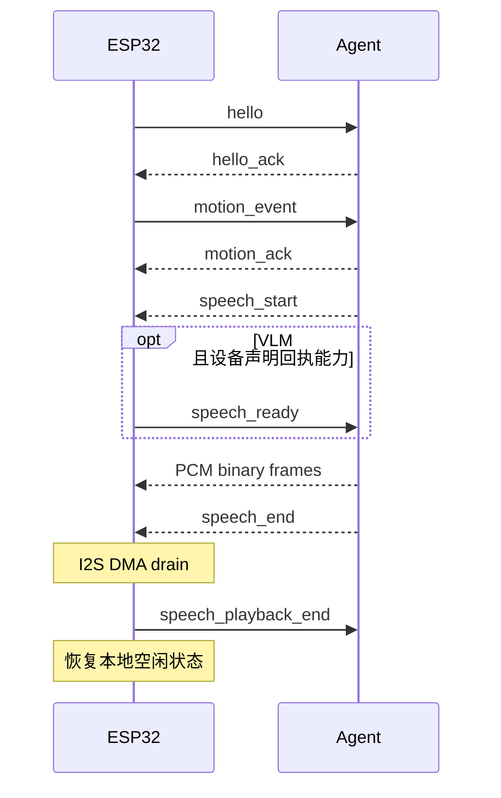
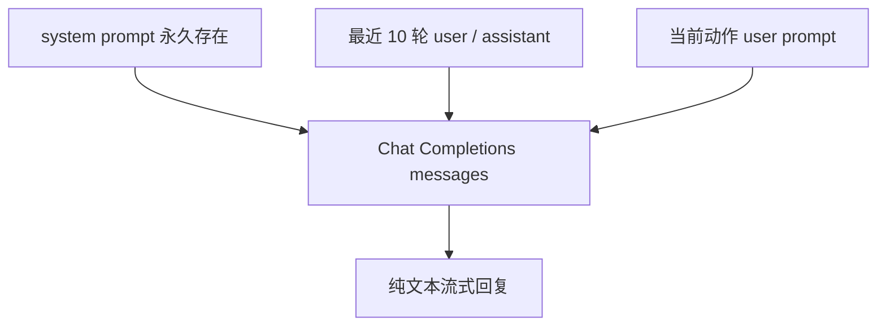

# Mimi 设备协议

当前协议版本是 `mimi.v1`，传输层是 WebSocket。控制消息使用 UTF-8 JSON 文本帧，音频使用二进制帧。

## 生命周期



`speech_start`、`speech_end` 和 `speech_error` 都属于同一个语音会话；动作和语音通过 `event_id` 关联。匹配当前动作的语音在收到 `speech_start` 后提交动作表情并释放音频。手动分析的 `event_id` 为空；没有匹配当前动作的语音直接释放音频，不复用上次动作表情。

## ESP32 → Agent

### `hello`

设备连接后发送一次：

```json
{
  "type": "hello",
  "device_id": "mimi-c3-01",
  "protocol": "mimi.v1",
  "audio": {
    "format": "pcm_s16le",
    "sample_rate": 16000,
    "channels": 1
  },
  "capabilities": ["speech_ready", "speech_playback_end"]
}
```

`capabilities` 是可选能力列表。当前固件声明两项回执；只有同时声明两项时，VLM 语音输出才启用等待机制。旧设备省略此字段时，Agent 仍发送音频，但不能确认播放完成。legacy 路径不等待这两项回执。

### `speech_ready`

设备成功启动 PCM 播放器并释放语音音频时发送：

```json
{"type":"speech_ready","speech_id":"sp-123"}
```

支持回执的 VLM 语音链路收到该消息后才发送 PCM。

### `speech_playback_end`

收到 `speech_end` 且 PCM 缓冲与 I²S 尾部播放完成后发送：

```json
{"type":"speech_playback_end","speech_id":"sp-123"}
```

Agent 按 `speech_id` 关联回执；未知或重复回执不会完成其他语音任务。

### `motion_event`

动作事件是固件运动估计器的结果，不是每 20 ms 一条原始 IMU 数据：

```json
{
  "type": "motion_event",
  "event_id": "evt-123456",
  "event": "shaking",
  "behavior": "dizzy",
  "intensity": 0.72,
  "timestamp_ms": 123456,
  "roll_deg": 1.2,
  "pitch_deg": 14.9,
  "angular_speed_dps": 125.0,
  "acceleration_norm_g": 1.08,
  "dynamic_acceleration_g": 0.08,
  "stability": 0.42,
  "tilt_strength": 0.25,
  "peak_angular_speed_dps": 210.0,
  "peak_dynamic_acceleration_g": 0.31,
  "confidence": 0.94,
  "still_duration_ms": 0,
  "state_duration_ms": 60,
  "motion_duration_ms": 680
}
```

当前可触发 Agent 语音策略的事件包括：

| event | 含义 |
|---|---|
| `touch` | TTP223 被触摸 |
| `tilt_left` / `tilt_right` | 向左/向右倾斜 |
| `tilt_forward` / `tilt_backward` | 向前/向后倾斜 |
| `shaking` | 摇晃 |

### `sensor_telemetry`

传感器遥测用于日志、诊断与视觉模式的当前感知输入，不单独触发模型推理：

```json
{
  "type": "sensor_telemetry",
  "timestamp_ms": 123456,
  "accel_x_g": 0.48,
  "accel_y_g": 0.04,
  "accel_z_g": 0.86,
  "gyro_x_dps": -5.0,
  "gyro_y_dps": -13.2,
  "gyro_z_dps": -7.1,
  "state": "shaking",
  "behavior": "dizzy",
  "touch_active": false,
  "roll_deg": 1.2,
  "pitch_deg": 14.9,
  "angular_speed_dps": 125.0,
  "motion_intensity": 0.72,
  "acceleration_norm_g": 1.08,
  "dynamic_acceleration_g": 0.08,
  "stability": 0.42,
  "tilt_strength": 0.25,
  "peak_angular_speed_dps": 210.0,
  "peak_dynamic_acceleration_g": 0.31,
  "confidence": 0.94,
  "still_duration_ms": 0,
  "state_duration_ms": 60,
  "motion_duration_ms": 680
}
```

## Agent → ESP32

### `hello_ack`

```json
{"type":"hello_ack","protocol":"mimi.v1"}
```

### `motion_ack`

Agent 对每一个动作事件回复一次：

```json
{"type":"motion_ack","event_id":"evt-123456","will_speak":true}
```

`will_speak=false` 表示动作未被接受，例如证据不足、处于冷却窗口或 legacy 当前语音优先级更高。`true` 表示接受处理，不保证一定产生语音：视觉采集失败、模型报错或回复被抑制时仍可能不播放。VLM 忙时只保留最新一个待处理传感器事件。

### `speech_start`

第一块可播放 PCM 已经从 TTS 到达 Agent 后发送：

```json
{
  "type": "speech_start",
  "speech_id": "sp-123",
  "event_id": "evt-123456",
  "text": "别晃啦，",
  "text_complete": false,
  "format": "pcm_s16le",
  "sample_rate": 16000,
  "channels": 1
}
```

legacy 的 `text` 是当前提交给 TTS 的文本前缀，不保证是完整回复；`text_complete=true` 表示 LLM 已经完成。VLM 在得到完整回复后才开始 TTS，因此发送完整文本和 `text_complete=true`；手动分析的 `event_id` 为空字符串。

### PCM 二进制帧

`speech_start` 后的二进制 WebSocket 帧全部是：

- little-endian；
- signed 16-bit；
- mono；
- 16 kHz；
- 每帧不超过 4096 字节；
- 偶数字节长度，不能拆开一个 PCM sample。

设备把 mono PCM 复制到 I²S 左右声道，并在固件中进行数字音量缩放。

### `speech_end`

```json
{"type":"speech_end","speech_id":"sp-123"}
```

该消息表示 Agent 已经发送全部 PCM，不代表扬声器已经停止。ESP32 还要等待 I²S DMA 尾部播放完成，随后发送 `speech_playback_end`，本地产生播放完成状态并恢复默认表情。VLM 输出等待支持该能力的设备回执后才确认完成；未声明能力时仅确认发送完成。

### `speech_cancel` 和 `speech_error`

```json
{"type":"speech_cancel","speech_id":"sp-123"}
```

```json
{
  "type": "speech_error",
  "speech_id": "sp-123",
  "event_id": "evt-123456",
  "message": "TTS request failed"
}
```

设备收到取消或错误后会停止当前 PCM、取消等待中的表情，并回到空闲状态。

## legacy 内部 LLM messages

每次请求使用以下结构：



历史按设备连接隔离，超过 10 轮后移除最早完整轮次。只有 LLM 收到完成标记并生成非空回复后，当前轮次才会写入历史；在 LLM 生成阶段被取消的任务不会成为下一轮上下文。

## VLM 输入与回复

视觉模式使用固定 system prompt、示例对话和当前感知文本，没有 legacy 的 10 轮历史。Ollama 请求携带当前 JPEG；llama-server 请求携带最近完成的视频片段（`input_video`）。回复为完整自然语言，不是设备控制 JSON。

WebUI 与 Agent 使用独立的浏览器 WebSocket，不属于 ESP32 设备协议。页面通过 `manual_analyze` 触发分析；Agent 用 `capture_request` 或 `capture_video_request` 请求媒体。图片以 JPEG Data URL 返回；视频先返回 `camera_video_meta`，再发送二进制视频帧。没有可用视频时返回 `camera_video_unavailable`。
