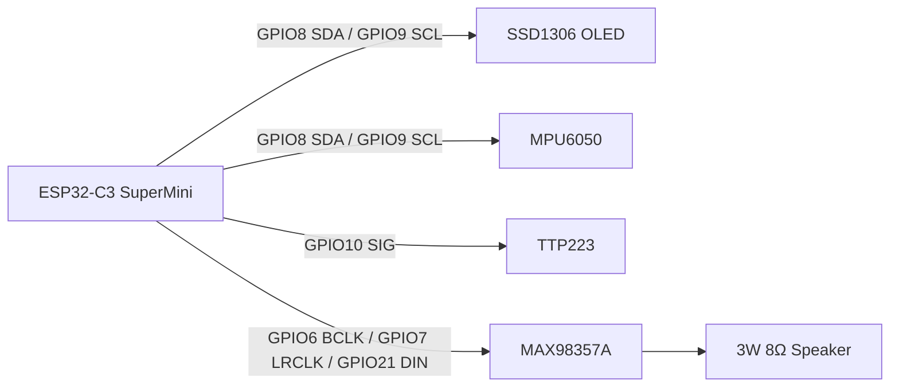

# 接线与供电

本文针对当前 ESP32-C3 SuperMini 原型配置。接线前断开 USB 和外部电源，确认所有模块的 GND 共地。

## 总线关系



## ESP32 引脚表

| 功能 | ESP32-C3 GPIO | 当前配置 |
|---|---:|---|
| I²C SDA | GPIO8 | OLED 和 MPU6050 共用 |
| I²C SCL | GPIO9 | OLED 和 MPU6050 共用 |
| TTP223 SIG | GPIO10 | 高电平表示触摸，50 ms 消抖 |
| I²S BCLK | GPIO6 | MAX98357A `BCLK` |
| I²S LRCLK | GPIO7 | MAX98357A `LRC` / `LRCLK` |
| I²S DOUT | GPIO21 | MAX98357A `DIN` |
| MPU6050 INT | GPIO3 | 当前未使用，可不接 |

引脚的唯一配置来源是 [firmware/config/pins.h](../firmware/config/pins.h)。如果更换开发板或重新安装模块，不要直接改业务代码，只修改该配置并重新做 I²C 扫描。

## OLED

当前 OLED 是 4 针 I²C 模块：

| OLED | ESP32-C3 |
|---|---|
| GND | GND |
| VCC | 3V3 |
| SCL | GPIO9 |
| SDA | GPIO8 |

常见地址是 `0x3C`，固件同时支持 `0x3D`。启动日志应看到 `OLED ready at 0x3C` 或 `OLED ready at 0x3D`。

## MPU6050

| MPU6050 | ESP32-C3 |
|---|---|
| VCC | 3V3 |
| GND | GND |
| SCL | GPIO9 |
| SDA | GPIO8 |
| AD0 | 悬空或接 GND，默认地址 `0x68` |
| INT | 不接 |
| XDA / XCL | 不接 |

正常日志：

```text
I2C device found at 0x68
MPU6050 ready at 0x68, WHO_AM_I=0x68
```

当前原型的前后方向校准位于 [firmware/config/motion.h](../firmware/config/motion.h)。如果 MPU6050 旋转安装，只调整 `MPU6050_PITCH_SIGN`，不要在表情代码里反转方向。

## TTP223

| TTP223 | ESP32-C3 |
|---|---|
| VCC | 3V3 |
| GND | GND |
| SIG | GPIO10 |

启动日志：

```text
TTP223 ready: SIG=GPIO10 active=HIGH debounce=50ms
```

触摸时应出现：

```text
touch: pressed pin=10
touch: released
```

## MAX98357A 和扬声器

从你这块模块正面、文字朝向自己观察，底部 7 个焊盘从左到右的物理顺序是：

```text
LRC    BCLK    DIN    GAIN    SD    GND    VIN
```

| MAX98357A | ESP32-C3 / 电源 |
|---|---|
| `BCLK` | GPIO6 |
| `LRC` / `LRCLK` | GPIO7 |
| `DIN` | GPIO21 |
| `GND` | 与 ESP32 共地 |
| `VIN` | 按模块规格供电；当前原型优先使用 5V/VIN |
| `GAIN` | 依模块默认配置，当前不接 |
| `SD` | 依模块默认配置，当前不接 |
| 顶部 `TP1`（+） | 扬声器正端 |
| 顶部 `TP2`（-） | 扬声器负端 |

注意：

- `BCLK`、`LRC`、`DIN` 是 ESP32 的 3.3V 数字信号；
- MAX98357A 的 `VIN` 不是 ESP32 GPIO，必须按模块规格供电；
- 扬声器两根线接功放的 `+` 和 `-`，不要把扬声器负端接 GND；
- 未确认功放模块的电源范围前，不要把 5V 接 OLED、MPU6050 或 TTP223；
- 先不接扬声器时也可以编译、烧录和验证 OLED/传感器，但 I²S 播放器初始化不等于已经听到声音。

## 面包板供电

面包板的红蓝电源轨不一定贯通，也不一定与另一侧相连。接线前用万用表确认：

1. ESP32 的 `3V3` 只连接低压模块的 VCC；
2. ESP32 的 `5V` / USB 电压只连接明确支持 5V 的模块；
3. 所有模块的 GND 连接到同一公共地；
4. 不要根据杜邦线颜色推断电压，颜色只是人为标记；
5. ESP32 不必插在面包板中央，可以用杜邦线连接，但每根线必须对应到明确的 GPIO 或电源点。

## I²C 地址检查

```bash
platformio device monitor --port /dev/cu.usbmodemXXXX --baud 115200
```

预期同时看到：

```text
I2C device found at 0x3C
I2C device found at 0x68
```

如果 GPIO8/9 无设备，再依据实际开发板原理图验证 GPIO4/5。不要在没有确认板型的情况下同时改变 SDA、SCL 和传感器地址。
